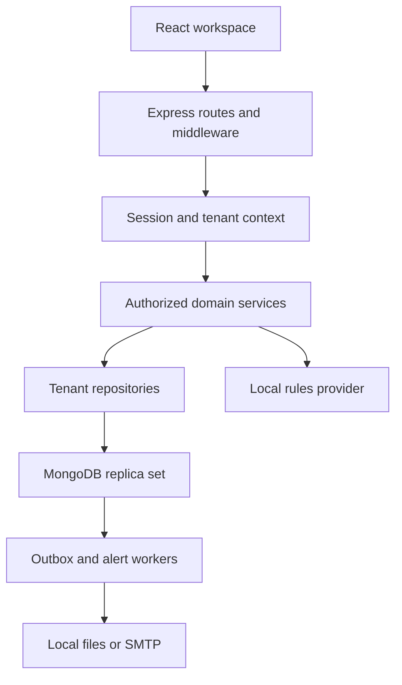

# Architecture

## Application shape

The repository is an npm workspace with a React SPA in `client`, an Express API in `server`, root operational scripts, tests and documentation. It is a modular monolith: one application process and one MongoDB replica set, with no Redis, message-broker service, microservices or paid AI service.

Routes parse strict input, invoke a service and return a consistent envelope. Services own access and business invariants. Repositories enforce a trusted organization filter around all tenant-owned reads and writes. A separate identity repository handles the explicitly different platform/authentication data paths.

## Source map

| Path | Responsibility |
| --- | --- |
| `client/src/api` | Credentialed Axios client, CSRF header and single-flight refresh |
| `client/src/stores` | In-memory session identity, UI refresh signals and toasts |
| `client/src/hooks` | Cancellable loading, debounced queries, pagination and mutation feedback |
| `client/src/components` | Reusable accessible primitives, selectors, dialogs, tables and state feedback |
| `client/src/features` | Authentication, entity forms, task detail and chart implementations |
| `client/src/pages` | Platform, dashboard, people, structure, projects, tasks, leave, intelligence and settings |
| `server/src/config` | Configuration validation, connection, indexes and transaction entry points |
| `server/src/models` | Mongoose schemas and indexes |
| `server/src/repositories` | Tenant-safe data operations and explicit identity operations |
| `server/src/services` | Workflow, authorization, scoping, notifications, mail and intelligence orchestration |
| `server/src/intelligence` | Pure rules and read-only provider contract |
| `server/src/middleware` | Origin/custom-header checks, authentication, CSRF and role gates |
| `server/src/validators` | Strict Zod schemas, bounded input and identifiers |
| `server/src/utils` | Pure domain rules, password/token/email cryptography, errors |
| `server/scripts` | First-admin bootstrap, demo seed and shared test fixtures |
| `tests` | Core behavior tests and separate MongoDB-backed API tests |

## Data model

| Collection | Key relationships / purpose |
| --- | --- |
| Organization | Unique slug, one canonical `adminUserId`, active flag, work/leave policy and delegate |
| User | Unique email, organization, role, password hash, invitation/access status |
| Employee | One user, one organization, department, team, reporting manager, skills and capacity |
| Department | Tenant grouping and optional head |
| Team | One department and optional leader; membership comes from Employee.teamId |
| Project | One manager, assigned teams and explicit members, dates, state and revision |
| Task | One project, optional assignee/team, same-project dependency references, effort and completion evidence |
| LeaveRequest | Requesting employee, date window, working-day count, decision and revision |
| Session | Hashed opaque credentials, expiry, CSRF value, rotation/replay state |
| ActionToken | Hashed single-use invitation/reset token and expiry |
| Notification | Tenant and recipient, idempotent event key, read state and destination |
| Activity | Tenant, actor and resource summary; role-scoped visibility |
| Mail | Encrypted body, recipient, event key, attempts, lease and delivery state |

MongoDB references are not foreign keys. Services validate referenced records within the tenant and transaction. The organization admin pointer, User role and Employee role are created or transferred atomically. Authentication verifies pointer/role agreement, so a role field alone does not grant administrator ownership.

Indexes cover identity uniqueness, tenant/resource uniqueness, common tenant/status/project/assignee/date filters, event deduplication and expiration. `connectDatabase` creates declared indexes at startup. Existing production schemas require a deliberate migration process before future breaking changes; this release starts with a clean database.

## Consistency

MongoDB transactions protect onboarding, invitations, employee access changes, structure/project/task edits, leave decisions, and administrator transfer. Organization-scoped mutations first write `operationVersion` on the active organization, then revalidate the current user and employee. This serializes organizational writes and avoids cross-collection write skew during membership, ownership and leave changes.

Resources use `revision` for optimistic concurrency. Clients must submit the last read revision with edits. A stale edit returns 409 instead of silently overwriting another user's changes. Parent/project and employee locks additionally make dependency and leave operations explicit. Transaction retries may repeat database work; external email is therefore recorded in an outbox and sent after commit.

The coarse organization lock limits write throughput for a busy tenant. It is acceptable as a conservative baseline, but load testing should determine when to split locks by aggregate. Unrelated tenants and ordinary reads can execute concurrently. This is not a distributed consistency proof or a substitute for integration testing.

## Authentication lifecycle

Passwords use Node's scrypt with independent salts. Sign-in returns short-lived opaque access and rotating refresh credentials in HttpOnly cookies, plus a session-bound CSRF value. Only hashes of access/refresh and action tokens are stored. Access lasts 15 minutes; refresh expires after seven days without an endlessly extended lifetime.

The client keeps identity in memory and recovers it through `/auth/me`, using refresh when needed. Mutation requests require a custom header and, after authentication, matching CSRF header/cookie/session values. Production cookies are Secure. Password reset, account deactivation, organization deactivation and administrator transfer invalidate affected sessions. The immediately preceding rotated refresh credential is tracked for replay revocation.

## Client and server efficiency

- Lazy route and chart modules, cached browser modules, bounded list pages, debounced search and cancelled stale requests.
- Lean MongoDB reads, selected fields for scheduling, batched name enrichment, query time bounds and a connection pool capped at ten.
- Explicit caps on analytical snapshots; no unbounded collection export endpoint.
- Local rules with no network latency or paid inference.
- One analysis snapshot per leave-impact request, reused across suggested replacements.
- Compressed API responses; production assets served from the same Express process.
- Polling only while the page is visible; no unnecessary websocket infrastructure.

Some management operations legitimately query related records and scope lists. There is no sustained load benchmark, distributed cache or guarantee of a latency target. Search uses escaped, bounded regex queries; very large directories should use an appropriate indexed search strategy and cursor pagination after profiling.

## Background work and deployment

Mail processes in batches of at most twenty every ten seconds, with a lease and up to five delivery attempts. Daily event keys deduplicate hourly deadline, workload and risk alerts. The worker runs inside the persistent Express process. Horizontal replicas may share the outbox lease, but alerts and rate limits are not a fully distributed job/rate-limit system.

Default deployment is same-origin: Express serves `client/dist` and `/api/v1`. During development Vite proxies `/api` to Express. A static-only host cannot execute the backend or background jobs. See `DEPLOYMENT.md` before hosting.
