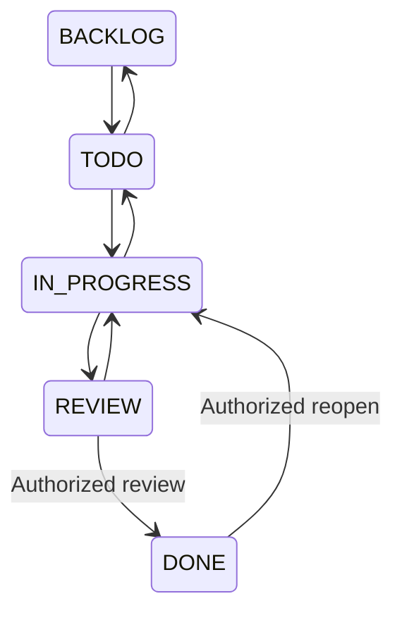

# Features and access rules

## Role matrix

Every API request checks the active session, account, organization and employee. Hiding a navigation item is only a convenience; the server enforces access independently.

| Capability | Super admin | Organization admin | Project manager | Team leader | Employee |
| --- | --- | --- | --- | --- | --- |
| Create/activate organizations | Yes | No | No | No | No |
| View tenant operations | No | Own organization | Managed projects and permitted people | Led-team work in visible projects | Own tasks and permitted project summaries |
| Invite/edit employees | No | Yes | No | No | No |
| Manage departments/teams | No | Yes | No | No | No |
| Create/manage projects | No | Yes | Managed projects; eligible resources only | No | No |
| Create/edit/assign tasks | No | Yes | Managed projects | Authorized led-team tasks | No |
| Update task progress | No | Yes | Authorized tasks | Authorized tasks | Own tasks |
| Approve DONE / reopen | No | Yes | Managed projects | Authorized led-team tasks | No |
| Submit own leave | No | Yes | Yes | Yes | Yes |
| Decide leave | No | Others in organization | Eligible direct reports; admin if delegate | Employee direct reports | No |
| Planning recommendations | No | Organization | Authorized managed work | Authorized team tasks | Own workload and delivery evidence only |
| Change organization policy | No | Yes | No | No | No |
| Read notifications | No tenant feed | Own | Own | Own | Own |

An employee directory is also scoped; it is not an unrestricted way for one manager to enumerate all tenant employees. Cross-tenant detail requests normally return 404, and an organization ID submitted in a resource body is rejected.

## People and structure

Employee records include name, fixed sign-in email, job title, role, department, team, reporting manager, skills, experience, joining date, weekly capacity and access status. Email changes are not exposed in this release. New users are INVITED until they set a password. Disabled users lose sessions and cannot activate old invitations.

Reporting requires a higher role, preventing self-reporting and role cycles. Team membership must agree with the employee's department. A team's leader must be an active TEAM_LEADER assigned to that team. Department heads are active employees.

Deactivation is blocked while the employee has unfinished tasks, live management/leadership duties, active direct reports, a pending leave request, or a leave-delegate assignment. Resolve those responsibilities first. Team changes require unfinished task handover. Departments and teams cannot be archived while active dependents still use them. These checks preserve useful historical records; they are not destructive cascades.

## Projects

Projects have unique tenant codes, name, description, manager, teams, explicit members, dates, status, priority, tags and required skills. Dates must be ordered and no more than one year apart. Task dates must remain within the project dates. Project memberships must reference active, accessible employees and teams in the same tenant.

Statuses are PLANNING, ACTIVE, ON_HOLD, COMPLETED and CANCELLED. Completion requires at least one task and all tasks DONE. Only completed or cancelled projects can be archived. Removing members or teams cannot strand unfinished assignments. Archived and cancelled projects retain their history but are excluded from active capacity and alert calculations. ON_HOLD work still reserves capacity until management updates the plan.

## Tasks

Tasks include one optional assignee, optional team, priority, start/deadline, description, estimates, remaining hours, complexity 1–5, tags, required skills, dependencies and a blocker reason. Assigned people must be active and eligible for the project and selected team. Dependencies must belong to the same project; self-dependencies and cycles are rejected. A project supports up to 3000 tasks in this release.

Employees can update their own task status, remaining hours and blocker reason. Management-only fields remain protected. Moving into REVIEW or DONE requires all dependencies complete and no blocker reason. DONE records receive completion time, reviewer, assignee snapshot and zero remaining effort. Reopening increments the reopen count; reopening a prerequisite is rejected if it would invalidate a completed dependent task.

The board supports mouse dragging and explicit status menus. The latter also work without dragging on touch and keyboard paths. Board and list views display the current filtered page; pagination labels show the total matching records. Loading, empty, error and revision-conflict feedback are included.

## Leave

Employees submit PAID, SICK or UNPAID leave beginning today or later. Dates use UTC calendar days and the organization's working-day settings. A request must contain 1–60 working days, remain in one calendar year and not overlap another pending or approved request for that person. Split requests crossing the year boundary.

The reporting manager, an eligible higher authority, or the organization admin decides the request. The administrator's own request goes to the configured project-manager delegate. Self-approval is always rejected. Rejection needs a short explanation. A requester can cancel pending leave or approved leave whose start date is still in the future.

Paid entitlement is annual and shared by all employees under the configured policy. Approval checks previously approved paid days in that request's year; pending requests are displayed separately and do not reserve the balance. Sick and unpaid leave do not consume paid entitlement. The balance card shows the current UTC calendar year. There is no carryover, prorated accrual, holiday calendar or statutory-policy automation.

Changing working-day settings affects future calculations and planning. Existing requests retain their recorded day count. Managers should avoid changing policy mid-request without reviewing the affected records.

## Intelligence and analytics

The application includes five rules-based planning capabilities, detailed in `INTELLIGENCE.md`. Each uses scoped database records and returns reasons rather than unexplained labels. Applying a suggested assignee goes through the same authorized, revision-checked task update as a manual edit. There is no background AI mutation.

Dashboards show real database totals, task status/priority charts, eight-week completion counts, project health, upcoming deadlines and recognition evidence. Lower-role metrics use permitted task details. Capacity can include scheduling totals from other assignments of a visible person without exposing those tasks' titles or descriptions. Scoping notes explain this distinction.

## Notifications and activity

Assignments, project changes, leave requests/decisions and planning alerts create in-app notifications and queued mail. Notifications are private to their recipient and can be marked read individually or together. The header polls the unread count every 60 seconds while the page is visible.

Mail is processed every 10 seconds with retries. Alerts run on startup and hourly, with event keys to deduplicate each day's deadline, overload and risk messages. The application process must stay running. Delivery is at least once: a crash after SMTP delivery but before recording success can duplicate an email. Notifications expire after 90 days, activity after 180 days, and mail records after 7 days through TTL indexes.

## Interface

The UI includes role-based navigation, organization and account context, responsive sidebar, searchable paginated lists, task board, modal forms, inline errors, feedback toasts, empty states, light/dark appearance, and data tables alongside charts. Native dialog behavior supports focus containment and Escape dismissal. Browser, keyboard, screen-reader and mobile validation remain release checks; implementation of these features is not a claim of a completed accessibility audit.
